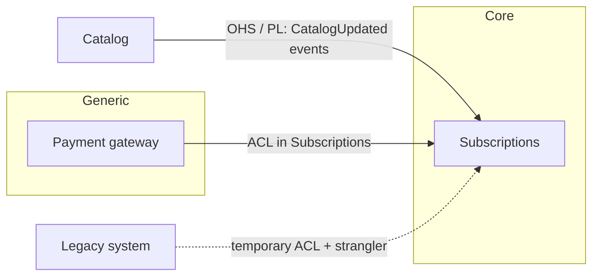

# Strategic design

Respond in the user's language; keep common technical terms in English. The first time you use a pattern, accompany it with its analogy.

Decides **where the boundaries go** between contexts and **how they relate**, before choosing technologies. Service boundaries that do not come from here usually come from the org chart by accident or from technology by fashion.

**Analogy:** it is urban planning. Before designing buildings you decide what is a residential neighborhood, what is an industrial zone and where the avenues run; changing that later is extremely expensive.

It fits with other skills: `domain-modeling` keeps each context's **language** (glossary and ADRs); `ddd-go-idiomatic` resolves the **tactical design** inside a context in Go; `system-design` uses these boundaries to decide services, data and communication.

## 1. Starting point: the current map

If there is an existing system (the normal case), **draw the AS-IS map first**, even if it is ugly. A target map without the current one is a wish, not a plan.

Sources for the current map, in order of reliability:

1. **Data**: which service writes each table, collection or topic. Two services that write the same thing are, in fact, a single context with a false boundary.
2. **Code**: dependencies between modules and services, synchronous calls, published and consumed events.
3. **Change coupling**: which files or services change together in the same commits. What always changes together belongs together. See [references/change-coupling.md](references/change-coupling.md).
4. **Language**: where the same word means different things ("subscription" for billing is not "subscription" for the catalog). Language divergence marks a natural boundary.
5. **Teams**: who owns what and who has to coordinate with whom to deliver (Conway's law).

If there is no system of your own but there is a similar documented one (a published case, a system from another company in the same domain), use it as a reference map and mark the context differences.

If there is neither a system nor a reference (exploratory design or PoC), start from the **typical subdomains of the business archetype** (`business-archetypes`) as a first draft, and adjust them with the user: what is core for this specific business may differ from the archetype.

## 2. Classify the subdomains

For each area of the business, decide:

- **Core**: what differentiates the business. This is where the best design, the best team and in-house code go.
- **Supporting**: necessary and specific to the business, but it does not differentiate. Good-enough design, no over-engineering.
- **Generic**: a problem the market has solved (authentication, standard payments, notifications). Buy it or use a service, and protect yourself from it with a boundary.

**Analogy:** in a restaurant, the kitchen is core, accounting is supporting and electricity is generic: nobody makes their own power.

The classification decides how much to invest, not how many services to create.

## 3. Draw the context boundaries

A boundary is good when:

- The **invariants** that must be transactionally consistent stay inside (a rule that crosses the boundary forces sagas or eventual consistency).
- Each context **owns its data**; the others reference it by ID or receive events.
- The **language** is coherent inside and can diverge outside.
- What **changes together** stays together.
- One team can own the whole context.

A context is not necessarily a deployable service: it can be a module inside a modular monolith. The decision to deploy separately comes later (`building-blocks`, `service-decomposition` block).

## 4. Name each relationship with its pattern

For each pair of contexts that communicate, choose the pattern and write down why. The patterns, with their analogy, when to use them and their risk, are in [references/context-map-patterns.md](references/context-map-patterns.md).

The questions that decide the pattern:

- Who depends on whom (upstream/downstream)?
- Does the upstream have incentives to serve the downstream's needs?
- Is the upstream's model healthy, or would it contaminate the downstream?
- How many consumers does the upstream have?

## 5. From the current map to the target

Draw the TO-BE map and, for each difference from the AS-IS, the **path**: which temporary pattern is used during the transition (typically an Anticorruption Layer in front of the legacy, a strangler fig to extract capabilities) and in which order. Each step must leave the system working.

## 6. Delivery

- **Context map** in Mermaid (AS-IS and TO-BE), with the pattern on each relationship.
- A table of subdomains with their classification and the investment it implies.
- A table of relationships: `Upstream → Downstream | Pattern | Why | Risk | When to revisit it`.
- The transition path.

Persist the map in `GLOSSARY-MAP.md` (`domain-modeling` format), adding the pattern to each relationship, or in the context section of the design doc if working inside `system-design`. Boundary decisions that are hard to reverse go as an ADR.

