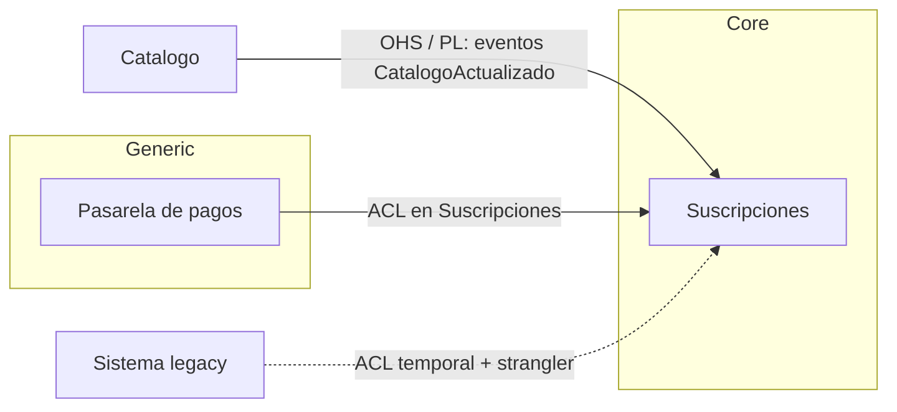

# Diseño estratégico

Responde en español y conserva en inglés los términos técnicos habituales. La primera vez que uses un patrón, acompáñalo de su analogía.

Decide **dónde van las fronteras** entre contextos y **cómo se relacionan**, antes de decidir tecnologías. Las fronteras de servicio que no salen de aquí suelen salir del organigrama por accidente o de la tecnología por moda.

**Analogía:** es el urbanismo. Antes de diseñar edificios se decide qué es barrio residencial, qué es zona industrial y por dónde pasan las avenidas; cambiar eso después es carísimo.

Encaja con otras skills: `domain-modeling` mantiene el **lenguaje** de cada contexto (glosario y ADRs); `ddd-go-idiomatic` resuelve el **diseño táctico** dentro de un contexto en Go; `system-design` usa estas fronteras para decidir servicios, datos y comunicación.

## 1. Punto de partida: el mapa actual

Si hay un sistema existente (lo normal), **dibuja primero el mapa AS-IS**, aunque sea feo. Un mapa objetivo sin el actual es un deseo, no un plan.

Fuentes del mapa actual, en orden de fiabilidad:

1. **Datos**: qué servicio escribe cada tabla, colección o topic. Dos servicios que escriben lo mismo son, de hecho, un solo contexto con una frontera falsa.
2. **Código**: dependencias entre módulos y servicios, llamadas síncronas, eventos publicados y consumidos.
3. **Acoplamiento de cambio**: qué archivos o servicios cambian juntos en los mismos commits. Lo que siempre cambia junto pertenece junto. Ver [references/acoplamiento-de-cambio.md](references/acoplamiento-de-cambio.md).
4. **Lenguaje**: dónde la misma palabra significa cosas distintas ("suscripción" para facturación no es "suscripción" para el catálogo). La divergencia de lenguaje marca una frontera natural.
5. **Equipos**: quién es dueño de qué y quién tiene que coordinarse con quién para entregar (ley de Conway).

Si no hay sistema propio pero sí uno parecido documentado (un caso publicado, un sistema de otra empresa del mismo dominio), úsalo como mapa de referencia y marca las diferencias de contexto.

Si no hay ni sistema ni referencia (diseño exploratorio o PoC), parte de los **subdominios típicos del arquetipo de negocio** (`business-archetypes`) como primer borrador, y ajústalos con el usuario: qué es core para este negocio concreto puede diferir del arquetipo.

## 2. Clasifica los subdominios

Para cada área del negocio, decide:

- **Core**: lo que diferencia al negocio. Aquí va el mejor diseño, el mejor equipo y el código propio.
- **Supporting**: necesario y específico del negocio, pero no diferencia. Diseño suficiente, sin sobreingeniería.
- **Generic**: problema resuelto en el mercado (autenticación, pagos estándar, notificaciones). Compra o usa un servicio, y protégete de él con una frontera.

**Analogía:** en un restaurante, la cocina es core, la contabilidad es supporting y la electricidad es generic: nadie fabrica su propia luz.

La clasificación decide cuánto invertir, no cuántos servicios crear.

## 3. Traza las fronteras de los contextos

Una frontera es buena cuando:

- Los **invariantes** que deben ser consistentes de forma transaccional quedan dentro (una regla que cruza la frontera obliga a sagas o a consistencia eventual).
- Cada contexto es **dueño de sus datos**; los demás los referencian por ID o reciben eventos.
- El **lenguaje** es coherente dentro y puede divergir fuera.
- Lo que **cambia junto** queda junto.
- Un equipo puede ser dueño del contexto completo.

Un contexto no es necesariamente un servicio desplegable: puede ser un módulo dentro de un monolito modular. La decisión de desplegar por separado es posterior (`building-blocks`, bloque `service-decomposition`).

## 4. Nombra cada relación con su patrón

Para cada par de contextos que se comunican, elige el patrón y escribe por qué. Los patrones, con su analogía, cuándo usarlos y su riesgo, están en [references/patrones-context-map.md](references/patrones-context-map.md).

Las preguntas que deciden el patrón:

- ¿Quién depende de quién (upstream/downstream)?
- ¿El upstream tiene incentivos para atender las necesidades del downstream?
- ¿El modelo del upstream es sano o contaminaría al downstream?
- ¿Cuántos consumidores tiene el upstream?

## 5. Del mapa actual al objetivo

Dibuja el mapa TO-BE y, para cada diferencia con el AS-IS, el **camino**: qué patrón temporal se usa durante la transición (típicamente una Anticorruption Layer frente al legacy, un strangler fig para extraer capacidades) y en qué orden. Cada paso debe dejar el sistema funcionando.

## 6. Entrega

- **Mapa de contextos** en Mermaid (AS-IS y TO-BE), con el patrón en cada relación.
- Tabla de subdominios con su clasificación y la inversión que implica.
- Tabla de relaciones: `Upstream → Downstream | Patrón | Por qué | Riesgo | Cuándo revisarlo`.
- El camino de transición.

Persiste el mapa en `MAPA-GLOSARIO.md` (formato de `domain-modeling`), añadiendo el patrón a cada relación, o en la sección de contexto del design doc si se trabaja dentro de `system-design`. Las decisiones de frontera difíciles de revertir van como ADR.

