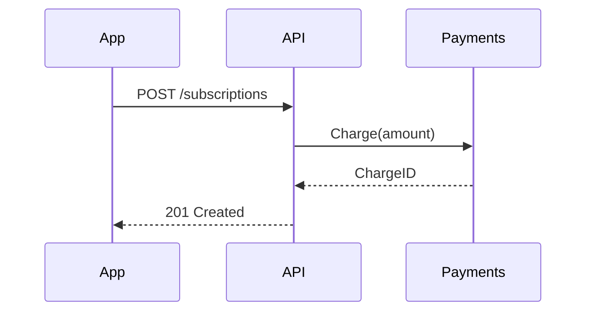

# Visuals for a PR summary

Menu of visuals for the summary section of a PR (or any explanation of a change). It comes from Dex Horthy's `show-me` skill via mattpocock/skills; see [../CREDITS.md](../CREDITS.md).

Choose the smallest view that makes the key point clear.

- Logic or an algorithm as pseudocode:

```text
on save
  if the content did not change
    return the cached result
  write the new content
  return the fresh result
```

- Runtime control flow as a call tree:

```text
Handler.RegisterDevice
  service.Register
    repo.CountByCustomer
    repo.Save
  publisher.Publish(DeviceRegistered)
```

- File responsibility or a broad refactor as a shallow file tree:

```text
internal/
├── devices/   # registration rules and limits
├── http/      # handlers and routing
└── kafka/     # publishes domain events
```

- Interaction between components, control flow or data flow with Mermaid:



- Use `diff` when the point is what changes and the surrounding shape already exists. Adapt the shape of the diff to the topic.

For a file layout change:

```diff
 internal/
 ├── devices/
+│   └── limits.go       # max-per-customer rule
 ├── http/
-└── kafka.go
+└── kafka/
+    ├── publisher.go
+    └── events.go
```

For a change in the call tree:

```diff
 Handler.RegisterDevice
   service.Register
     repo.CountByCustomer
+    limits.Validate
     repo.Save
-  publisher.Publish
+  outbox.Enqueue
```

For a change of state or control flow:

```diff
 on save
-  write the content
+  if the content did not change
+    return the cached result
+  write the new content
+  invalidate the cache
```

- Show the whole block when almost everything is new, when leaving out context would hide ownership or ordering, or when the reader needs a copyable shape:

```text
register(device):
    n = repo.countByCustomer(device.customerId)
    if n >= maxPerCustomer:
        return ErrLimitReached
    repo.save(device)
```

## Guide

Place each visual next to the short text it supports. Keep only the calls, files, states and boundaries needed to understand the change. You can use one of these or several; using all of them is rare. Use your judgment and do not overwhelm the reader.
