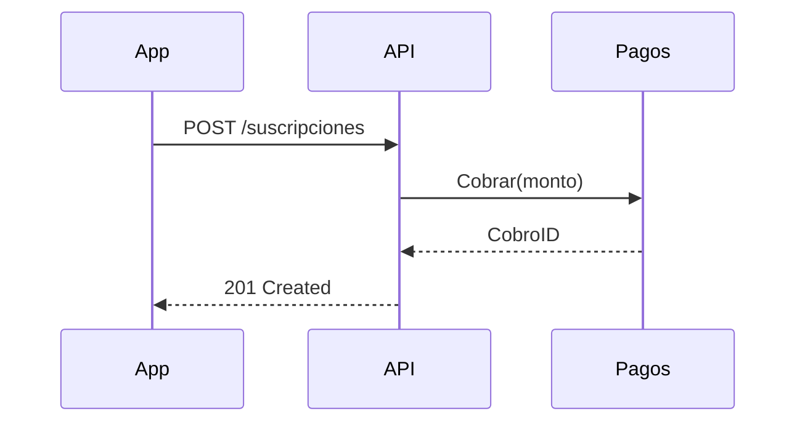

# Visuales para el resumen de un PR

Menú de visuales para la sección de resumen de un PR (o de cualquier explicación de un cambio). Viene de la skill `show-me` de Dex Horthy vía mattpocock/skills; ver [../CREDITS.md](../CREDITS.md).

Elige la vista más pequeña que deje claro el punto clave.

- Lógica o algoritmo como pseudocódigo:

```text
al guardar
  si el contenido no cambió
    devuelve el resultado cacheado
  escribe el contenido nuevo
  devuelve el resultado fresco
```

- Flujo de control en ejecución como árbol de llamadas:

```text
Handler.RegistrarDispositivo
  service.Registrar
    repo.ContarPorCliente
    repo.Guardar
  publisher.Publicar(DispositivoRegistrado)
```

- Responsabilidad de archivos o un refactor amplio como árbol de archivos poco profundo:

```text
internal/
├── dispositivos/   # reglas de registro y límites
├── http/           # handlers y routing
└── kafka/          # publica eventos de dominio
```

- Interacción entre componentes, flujo de control o de datos con Mermaid:



- Usa `diff` cuando el punto sea qué cambia y la forma de alrededor ya existe. Adapta la forma del diff al tema.

Para un cambio de layout de archivos:

```diff
 internal/
 ├── dispositivos/
+│   └── limites.go       # regla de máximo por cliente
 ├── http/
-└── kafka.go
+└── kafka/
+    ├── publisher.go
+    └── eventos.go
```

Para un cambio en el árbol de llamadas:

```diff
 Handler.RegistrarDispositivo
   service.Registrar
     repo.ContarPorCliente
+    limites.Validar
     repo.Guardar
-  publisher.Publicar
+  outbox.Encolar
```

Para un cambio de estado o de flujo de control:

```diff
 al guardar
-  escribe el contenido
+  si el contenido no cambió
+    devuelve el resultado cacheado
+  escribe el contenido nuevo
+  invalida el cache
```

- Muestra el bloque entero cuando casi todo es nuevo, cuando omitir contexto escondería propiedad u orden, o cuando el lector necesita una forma copiable:

```text
registrar(dispositivo):
    n = repo.contarPorCliente(dispositivo.clienteId)
    si n >= maxPorCliente:
        devolver ErrLimiteAlcanzado
    repo.guardar(dispositivo)
```

## Guía

Coloca cada visual junto al texto breve que apoya. Conserva solo las llamadas, archivos, estados y fronteras necesarios para entender el cambio. Puedes usar uno de estos o varios; es raro usarlos todos. Usa tu criterio y no abrumes al lector.
